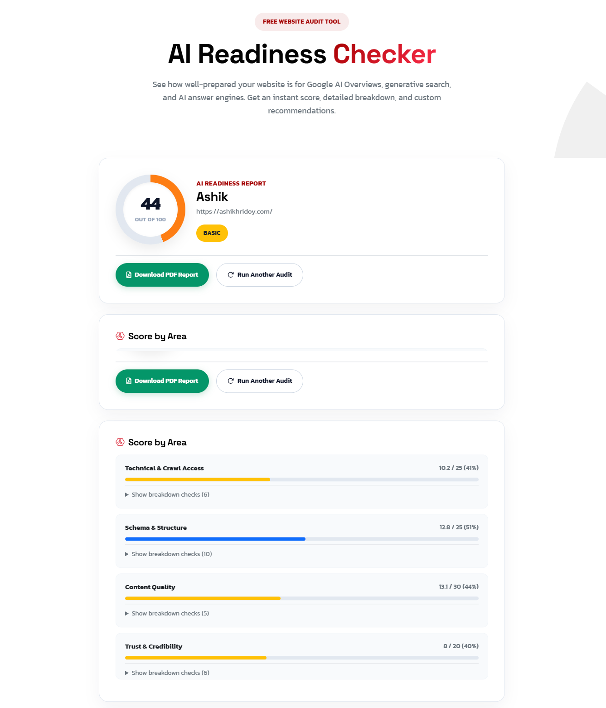
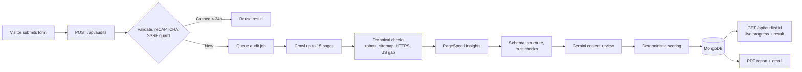

# AI Readiness Checker

**Built for Fospertise.** A backend service that crawls a company's website, runs 27 checks across technical SEO, structured data, content and trust, and returns an **AI Readiness Score out of 100**. The score shows how ready the site is to be read and cited by AI answer engines such as Google AI Overviews, ChatGPT, Perplexity and Gemini.

The tool doubles as a lead generator. A visitor submits a short form, watches the audit run live, gets a scored report with a prioritized fix list, and receives a branded PDF by email. Each submission is stored as a lead, and the sales team gets a weekly Excel export of all leads.


---

## Screenshot



---

## Highlights

- **End-to-end audit pipeline.** Crawling, technical checks, a mobile PageSpeed test, schema and structure analysis, an AI content review and scoring all run as a background job, with live progress the frontend can poll.
- **Deterministic scoring.** Gemini only returns ratings (integers from 0 to 10) and lists. Plain code in `scoring.js` calculates the final score, so the same input always gives the same score.
- **Fault tolerant.** If PageSpeed, Gemini or a single page fails, the audit does not stop. Items that could not be measured are taken out of the maximum instead of getting free points, and the result is marked `partial`.
- **Security first.** The server fetches URLs that users submit, so it has full SSRF protection: DNS resolution checks on every redirect, private and metadata IP ranges blocked, body size and content-type limits, and a sandboxed Playwright that aborts requests to non-public hosts.
- **Treats AI as untrusted.** Gemini output is validated against a zod schema and retried on failure. The system instruction tells the model to ignore any instructions found in crawled page content (prompt injection defense).
- **Lead pipeline.** Leads are stored in MongoDB, the PDF report is emailed with Nodemailer, and a cron job sends a weekly Excel export of leads (sanitized against spreadsheet formula injection).
- **Production ready.** Dockerized, with a GitHub Actions pipeline that runs tests against a real MongoDB service, builds and pushes the image to Docker Hub, and deploys to a Linux VPS.

---

## How it works



| Progress | Stage | Work |
| --- | --- | --- |
| 5% | Checking website | Fetch the homepage, fail early if it cannot be reached |
| 20% | Crawling pages | Crawl priority pages (home, about, services, contact, pricing, FAQ and more) |
| 40% | Technical checks | robots.txt AI bot rules, sitemap, HTTPS, raw vs rendered text ratio |
| 55% | Speed test | Google PageSpeed Insights (mobile), cached for 24 hours |
| 65% | Structure and trust | JSON-LD schema, headings, meta tags, About/Contact/legal pages, social proof |
| 80% | AI content review | Gemini rates direct answers, facts, clarity, originality and question coverage |
| 90% | Scoring | Weighted score, grade and the top 10 issues ranked by severity |
| 100% | Done | Result saved, PDF emailed |

Audits run with a concurrency limit of 2 and a 3-minute overall timeout.

---

## Scoring model

| Category | Points | What it measures |
| --- | --- | --- |
| Technical & Crawl Access | 25 | AI bot access in robots.txt (GPTBot, PerplexityBot, ClaudeBot, Google-Extended, CCBot), sitemap, HTTPS, mobile speed, viewport, JavaScript-only content |
| Schema & Structure | 25 | Organization, FAQ and content schema, JSON-LD validity, H1 usage, heading order, titles and meta descriptions, canonicals, lists and tables, image alt text |
| Content Quality | 30 | Gemini ratings for direct answers, concrete facts, offer clarity and originality, plus coverage of 15 likely customer questions |
| Trust & Credibility | 20 | About page, contact details, team or authors, social profiles, legal pages, testimonials and case studies |

**Grades:** 0–39 Not Ready · 40–59 Basic · 60–79 Good · 80–100 Strong

Every item that loses points becomes an issue with a plain-English title, why it matters, how to fix it, and the affected page. Issues are ranked by severity (high, medium, low) and points lost.

> **Honesty rule:** The tool never predicts rankings. Every report states: *"This score shows how ready your website is. It cannot promise a place in Google AI Overviews or any AI answer."*

The full formula is in [docs/SPEC.md](docs/SPEC.md).

---

## Tech stack

| Layer | Tools |
| --- | --- |
| Runtime and API | Node.js 22, Express 5 |
| Database | MongoDB Atlas, Mongoose |
| Crawling and parsing | Custom `safeFetch` crawler, Cheerio, p-limit |
| Rendering and PDF | Playwright (Chromium) |
| AI | Google Gemini via `@google/genai`, with structured JSON output |
| Performance data | Google PageSpeed Insights API v5 |
| Validation | Zod (env config, request body, AI output) |
| Security | Helmet, CORS allowlist, express-rate-limit, Google reCAPTCHA, honeypot field |
| Email and reports | Nodemailer, ExcelJS, node-cron |
| DevOps | Docker, Docker Compose, GitHub Actions, Linux VPS |
| Testing | Node's built-in `node:test` runner (80+ tests) |

---

## API

| Method | Endpoint | Description |
| --- | --- | --- |
| `POST` | `/api/audits` | Create a lead and start an audit. Returns `202 { auditId, status }`, or `200` with `cached: true` if the domain was audited in the last 24 hours |
| `GET` | `/api/audits/:id` | Progress (`queued`, `running`, `done`, `failed`), stage, and the full result when done |
| `GET` | `/api/audits/:id/pdf` | Download the branded PDF report (`409` if not ready) |
| `GET` | `/api/health` | Health check |

Errors always use the shape `{ "error": "Friendly message", "code": "SOME_CODE" }`. Stack traces, keys and user emails are never returned.

<details>
<summary>Example request</summary>

```bash
curl -X POST http://localhost:3000/api/audits \
  -H "Content-Type: application/json" \
  -d '{
    "companyName": "Acme Software",
    "website": "acme.com",
    "productsServices": "Custom web and mobile app development",
    "industry": "Software",
    "location": "Dhaka, Bangladesh",
    "email": "owner@acme.com",
    "consent": true
  }'
```

</details>

---

## Security

- **SSRF protection** (`urlGuard.js`, `safeFetch.js`): only `http` and `https` on ports 80 and 443. A and AAAA records are resolved and checked against loopback, private, link-local, cloud metadata and IPv4-mapped IPv6 ranges. Redirects are followed manually (max 5), and every hop is checked again. Requests time out after 10 seconds, bodies are capped at 2 MB, and only a short list of content types is accepted.
- **Sandboxed browser:** Playwright blocks images, fonts and media, and aborts any request to a host that fails the public-host check.
- **Abuse prevention:** 5 audits per hour per IP, 120 reads per minute, a 50 KB body limit, reCAPTCHA, and a honeypot field that returns a fake success to bots.
- **Input and output safety:** zod with strict schemas, all dynamic PDF text escaped, Excel cells sanitized against formula injection, and env config validated at startup without printing secrets.

---

## Project structure

```text
server.js                 Express app, middleware, error handling
src/
  config.js               Env validation with zod
  db.js                   MongoDB connection
  validators.js           Request schemas
  models/                 Lead, Audit
  routes/audits.js        API endpoints and rate limits
  jobs/
    runAudit.js           Audit pipeline with progress updates
    scheduler.js          Weekly leads export cron job
  services/
    urlGuard.js           URL normalization and SSRF guard
    safeFetch.js          Hardened HTTP client
    crawler.js            Priority-based site crawler
    browser.js            Playwright browser management
    pagespeed.js          PageSpeed Insights client with cache
    gemini.js             AI content review with schema validation and retries
    scoring.js            Deterministic scoring and issue builder
    report.js             HTML to PDF report
    email.js              Report and weekly export emails
    leadExporter.js       Excel export of leads
    recaptcha.js          reCAPTCHA verification
    checks/               technical, schema, jsonld, structure, trust
test/                     Unit and integration tests
scripts/                  Manual try scripts, e2e runner, lead export
docs/                     Specification and design docs
```

---

## Getting started

**Requirements:** Node.js 20+, a MongoDB database, a Gemini API key and a PageSpeed Insights API key.

```bash
git clone https://github.com/ahammedhridoy/fospertise-seo-audit-tool.git
cd fospertise-seo-audit-tool
npm install
npx playwright install chromium
cp .env.example .env      # then fill in the values
npm run dev
```

### Environment variables

| Name | Required | Description |
| --- | --- | --- |
| `MONGODB_URI` | yes | MongoDB connection string |
| `GEMINI_API_KEY` | yes | Google AI Studio key |
| `GEMINI_MODEL` | no | Gemini model name |
| `PAGESPEED_API_KEY` | yes | PageSpeed Insights API key |
| `ALLOWED_ORIGINS` | yes | Comma-separated CORS origins |
| `PORT` / `NODE_ENV` | no | Defaults: `3000` / `development` |
| `MAX_PAGES` | no | Pages crawled per audit (default 15) |
| `RECAPTCHA_SECRET` | no | Turns on reCAPTCHA when set |
| `REPORT_BRAND_NAME` / `_URL` / `_EMAIL` | no | Branding on the PDF |
| `SMTP_*`, `EMAIL_FROM`, `ADMIN_REPORT_EMAIL` | no | Email delivery and weekly export recipient |

### Scripts

| Command | Description |
| --- | --- |
| `npm run dev` | Start with file watching |
| `npm start` | Start in production mode |
| `npm test` | Run the test suite |
| `npm run e2e` | Run a full audit end to end against real sites |
| `npm run export:email` | Send the leads Excel export now |

### Docker

```bash
docker compose up -d --build
```

---

## CI/CD

Every push to `main` runs a GitHub Actions pipeline:

1. **Test:** installs dependencies and Chromium, starts a MongoDB 7 service container, and runs the full test suite.
2. **Build and push:** builds the Docker image and pushes it to Docker Hub.
3. **Deploy:** connects to the VPS over SSH, pulls the new image and restarts the container with Docker Compose.

---

## About this project

I built this as a client project for **Fospertise**, a software development company, as a lead-generation tool for their website. The service runs as a standalone API, and the frontend form lives on the company website.

**Author:** [Ahammed Hridoy](https://github.com/ahammedhridoy)
